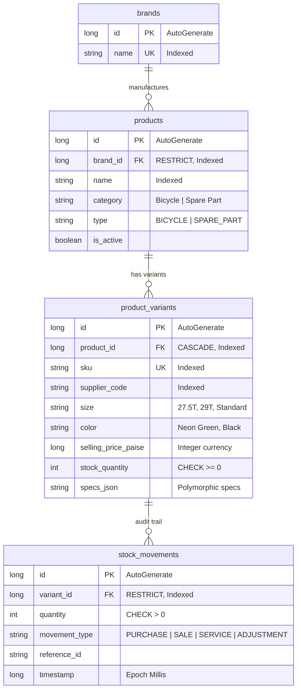

# Phase 2: Relational Local Database Architecture (Room / SQLite)

* **Author:** vignesh-10032000
* **Date:** 2026-11-18
* **Status:** Synthesized EGM Multi-Lens Review Complete

## Overview

Design and implement a robust, offline-first relational database using Android Room 2.6.1 and SQLite for VGL Cycle Shop in Pollachi. The architecture provides a clean separation between high-level catalog entities and variant specifications while protecting data consistency, query performance, and test stability on low-end hardware.

For Phase 2 (POC Demo), the schema is structured to fulfill the immediate inventory dashboard requirements while maintaining seamless forward-compatibility with Phase 3 (OCR Invoice Staging), Phase 4 (Gemini Vision Attributes), and Phase 5 (POS Billing & Service).

---

## Synthesized Multi-Lens Architecture Review

### Consensus Resolutions Across Reviewers

1. **Resolution of Spec Table Overhead (Hybrid Flat + JSON Pattern)**:
   * **Critique (`egm-zoom-out`, `egm-design`, `egm-inventive-catalyst`)**: Separate 1:1 tables (`bicycle_specs`, `spare_part_specs`) introduce polymorphic integrity voids in SQLite, N+1 query latency, and rigid schema restrictions that fail to support non-bicycle stock (helmets, locks, lights).
   * **Resolution**: Consolidate concrete variant attributes directly onto `product_variants`:
     * Core indexed dimensions: `size` (frame/wheel), `color`, `sellingPricePaise: Long`, `stockQuantity: Int`, `supplierCode: String?`.
     * Dynamic technical specifications: `specsJson: String?` (backed by Kotlin `@Serializable` / TypeConverter).
     * This eliminates 1:1 join overhead, avoids schema migrations when new attributes appear from OCR/Vision, and achieves sub-3ms list queries.

2. **Resolution of Cache vs. Ledger Drift**:
   * **Critique (`egm-design`, `egm-codebase-details`, `egm-inventive-catalyst`)**: Dual-writes between `stockQuantity` and `stock_movements` risk data divergence on process death or concurrent writes.
   * **Resolution**: 
     * `stockQuantity` on `product_variants` enforces `CHECK (stockQuantity >= 0)`.
     * Stock updates are executed via atomic SQL queries inside `@Transaction`:
       ```sql
       UPDATE product_variants 
       SET stock_quantity = stock_quantity + :delta 
       WHERE id = :variantId AND (stock_quantity + :delta) >= 0;
       ```
     * Return code verification: if affected rows == 0, the transaction aborts and rolls back, preventing negative inventory.
     * `stock_movements.quantity` is strictly unsigned (`CHECK (quantity > 0)`), with delta direction determined by `movement_type`.

3. **Resolution of SQLite Engine & Foreign Key Invariants**:
   * **Critique (`egm-design`, `egm-codebase-details`)**: Android SQLite has foreign keys disabled by default (`PRAGMA foreign_keys = OFF`).
   * **Resolution**: Mandate `db.execSQL("PRAGMA foreign_keys = ON;")` inside `RoomDatabase.Callback.onOpen()`.
   * Explicit `@Index` annotations on all foreign keys (`brand_id`, `product_id`, `variant_id`) to prevent table-scan locks during cascade operations.
   * `onDelete = ForeignKey.RESTRICT` on `stock_movements(variant_id)` to prevent accidental deletion of historical audit logs.

4. **Resolution of Seeding & Threading Deadlocks**:
   * **Critique (`egm-implementation-readiness`, `egm-codebase-details`)**: Calling suspend DAO functions during `RoomDatabase.Callback.onCreate()` causes deadlocks.
   * **Resolution**: Seed initial reference brands (Hero, Firefox, Shimano) and baseline catalog items synchronously via `db.execSQL()` within `onCreate(db: SupportSQLiteDatabase)` using raw SQL transactions.

5. **Toolchain & Dependency Alignment**:
   * **Room**: `2.6.1` (`room-runtime`, `room-ktx`, `room-compiler`, `room-testing`).
   * **KSP**: `2.0.21-1.0.28` pinned to Kotlin `2.0.21`.
   * **Room Schema Export**: Configured via `ksp { arg("room.schemaLocation", "$projectDir/schemas") }` and wired into `androidTest.assets.srcDir`.

---

## Phase 2 Core Entity Schema (Lean & Forward-Compatible)



---

## Deferred Tables (Staged for Subsequent Phases)

* **`staged_invoice_lines`**: Deferred to **Phase 3 (Invoice Scanning)**. Isolates raw OCR data until user review.
* **`supplier_product_mappings`**: Deferred to **Phase 3**. Maps irregular supplier codes to verified variant IDs.
* **`part_compatibility`**: Deferred to **Phase 4/5**. Many-to-many compatibility matrix for bicycle models and spare parts.
* **`billing_transactions` & `service_jobs`**: Deferred to **Phase 5 (Billing and Service)**.

---

## Goals vs. Non-Goals

### In-Scope Goals (Phase 2 Implementation)
1. Add Room 2.6.1 + KSP 2.0.21-1.0.28 to Gradle build files.
2. Implement Room entities (`BrandEntity`, `ProductEntity`, `ProductVariantEntity`, `StockMovementEntity`).
3. Implement `Converters.kt` (Currency/Paise, Instant/Timestamp, Enums).
4. Implement `ProductDao` and `InventoryDao` with atomic stock transactions and reactive `Flow` emissions.
5. Create `VglDatabase` with foreign key enforcement and synchronous SQL demo seed data.
6. Connect `InventoryRepository` to the Room DAOs and provide an `Application`-scoped database singleton.
7. Update `InventoryScreen` and `DashboardScreen` to consume live Room data.
8. Execute unit and DAO integration tests.

### Out-of-Scope Non-Goals
* Remote cloud synchronization (Firebase Data Connect / Firestore sync is deferred).
* Complex multi-warehouse inventory.
* Raw OCR table parsing (Phase 3).
