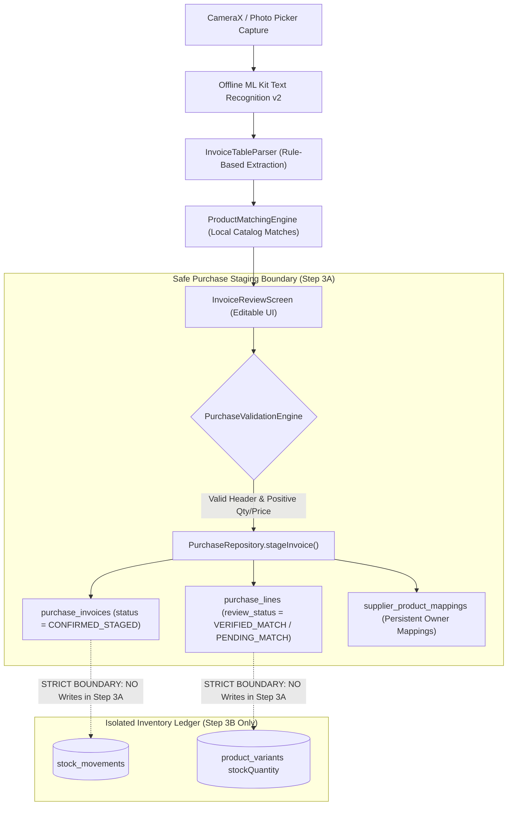
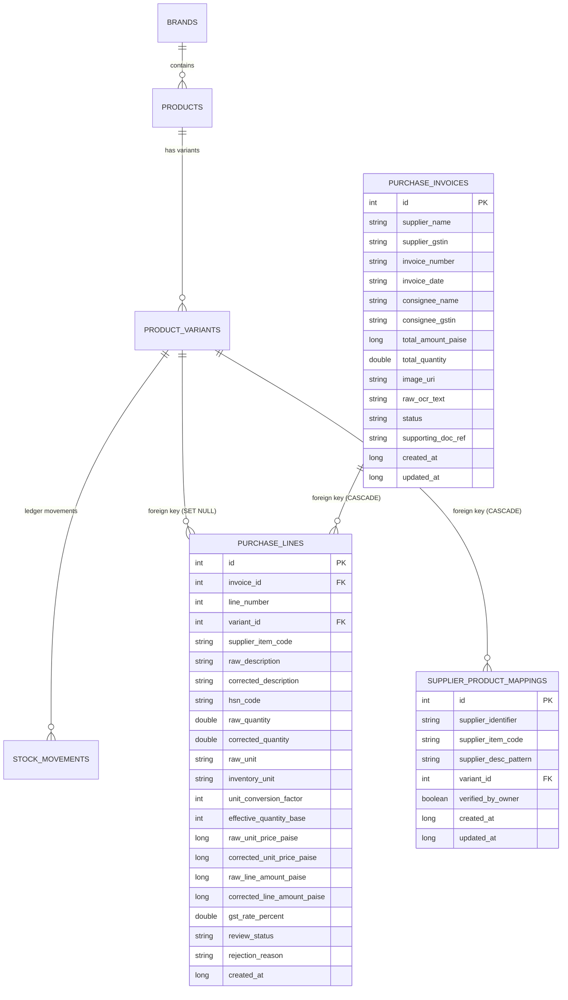

# VGL Cycle Shop — Phase 3 Step 3A: Safe Purchase Staging Architecture Report

**Project:** VGL Cycle Shop (`dev.vignesh.cycleshop`)  
**Phase:** 3 — Native Camera, Offline ML Kit OCR, and Supplier Purchase Staging  
**Step:** 3A — Safe Purchase Staging Architecture  
**Hardware Verified:** OnePlus 9R (`LE2101`, Android 14, OxygenOS) via ADB Wi-Fi (`192.168.0.9:37157`)  
**Strict Safety Constraint:** ZERO stock movements created. ZERO changes to inventory ledger or catalog quantities until owner-confirmed Step 3B. ZERO Gemini API / paid external AI calls.

---

## 1. Executive Summary & Architectural Overview

Phase 3 Step 3A transitions VGL Cycle Shop from raw invoice text extraction and UI candidate viewing into a **persisted, multi-table purchase staging architecture**. 

In high-volume retail like bicycle parts and assembly in Tamil Nadu, incoming supplier invoices (e.g., M.STEEL / MBW, Stryder Cycles, Hero) cannot directly increment shop inventory balances upon capture. Doing so risks:
1. Contaminating inventory ledgers with unverified or OCR-skewed quantities.
2. Inaccurate packaging conversions (e.g., inserting 10 Gross spokes as 10 single spokes instead of 1,440 spokes).
3. Accidental duplicate purchases when the shop owner scans an invoice more than once.
4. Auto-creating unmapped products that break existing catalog taxonomy.

Step 3A solves this by creating an isolated staging boundary where invoices are saved in Room as `CONFIRMED_STAGED`, line items preserve dual raw and corrected values, packaging units are deterministically converted, and **no row can touch inventory balances without owner verification**.



---

## 2. Room Schema Entities & Relationships

Room schema version was safely incremented from `1` to `2`.



### Detailed Entity Design
1. **`PurchaseInvoiceEntity` (`purchase_invoices`)**:
   - Represents the physical invoice header.
   - Preserves supplier name, GSTIN, invoice serial number, date, consignee details, and total amounts (in paise).
   - Stores `image_uri` (app-private file reference) and `raw_ocr_text` for complete auditability.
   - Status transitions: `DRAFT` → `NEEDS_REVIEW` → `CONFIRMED_STAGED` → `POSTED_TO_INVENTORY` → `REJECTED`.
   - Indexed on `(supplier_name, invoice_number)` and `(supplier_gstin, invoice_number)`.

2. **`PurchaseLineEntity` (`purchase_lines`)**:
   - Stores each line item extracted from the invoice table.
   - Dual-column architecture: retains `raw_description`, `raw_quantity`, `raw_unit_price_paise`, and `raw_line_amount_paise` alongside `corrected_description`, `corrected_quantity`, etc.
   - **Unit Tracking:** Stores `raw_unit` (e.g. "Gross"), `inventory_unit` (`PIECE`), `unit_conversion_factor` (144), and calculated `effective_quantity_base` (e.g. 1440).
   - **Foreign Keys:**
     - `invoice_id` → `purchase_invoices.id` (`ON DELETE CASCADE`): Deleting an invoice cleans up its staged lines.
     - `variant_id` → `product_variants.id` (`ON DELETE SET NULL`): If a product variant is removed from catalog, line records remain for historical purchase accounting.
   - Status transitions: `PENDING_MATCH`, `VERIFIED_MATCH`, `MANUAL_CORRECTED`, `UNMATCHED_REJECTED`.

3. **`SupplierProductMappingEntity` (`supplier_product_mappings`)**:
   - Remembers verified supplier codes/descriptions mapped to internal variants by the shop owner.
   - When subsequent invoices arrive from the same supplier, verified mappings achieve Tier 1 exact matches without manual re-entry.

---

## 3. Safe Database Migration (v1 → v2)

Room `MIGRATION_1_2` was designed as an append-only migration that strictly preserves all existing catalog entities (`brands`, `products`, `product_variants`) and all 9 opening stock movements (`stock_movements`, 67 total units):

```kotlin
val MIGRATION_1_2 = object : Migration(1, 2) {
    override fun migrate(db: SupportSQLiteDatabase) {
        // 1. Create purchase_invoices table & indices
        db.execSQL("""
            CREATE TABLE IF NOT EXISTS `purchase_invoices` (
                `id` INTEGER PRIMARY KEY AUTOINCREMENT NOT NULL,
                `supplier_name` TEXT NOT NULL,
                `supplier_gstin` TEXT,
                `invoice_number` TEXT NOT NULL,
                `invoice_date` TEXT,
                `consignee_name` TEXT,
                `consignee_gstin` TEXT,
                `total_amount_paise` INTEGER,
                `total_quantity` REAL,
                `image_uri` TEXT,
                `raw_ocr_text` TEXT,
                `status` TEXT NOT NULL DEFAULT 'CONFIRMED_STAGED',
                `supporting_doc_ref` TEXT,
                `created_at` INTEGER NOT NULL,
                `updated_at` INTEGER NOT NULL
            )
        """)
        db.execSQL("CREATE INDEX IF NOT EXISTS `index_purchase_invoices_supplier_name_invoice_number` ON `purchase_invoices` (`supplier_name`, `invoice_number`)")
        db.execSQL("CREATE INDEX IF NOT EXISTS `index_purchase_invoices_supplier_gstin_invoice_number` ON `purchase_invoices` (`supplier_gstin`, `invoice_number`)")
        db.execSQL("CREATE INDEX IF NOT EXISTS `index_purchase_invoices_status` ON `purchase_invoices` (`status`)")
        db.execSQL("CREATE INDEX IF NOT EXISTS `index_purchase_invoices_created_at` ON `purchase_invoices` (`created_at`)")

        // 2. Create purchase_lines table with CASCADE and SET NULL FKs
        db.execSQL("""
            CREATE TABLE IF NOT EXISTS `purchase_lines` (
                `id` INTEGER PRIMARY KEY AUTOINCREMENT NOT NULL,
                `invoice_id` INTEGER NOT NULL,
                `line_number` INTEGER NOT NULL,
                `variant_id` INTEGER,
                `supplier_item_code` TEXT,
                `raw_description` TEXT NOT NULL,
                `corrected_description` TEXT,
                `hsn_code` TEXT,
                `raw_quantity` REAL NOT NULL,
                `corrected_quantity` REAL,
                `raw_unit` TEXT NOT NULL,
                `inventory_unit` TEXT NOT NULL DEFAULT 'PIECE',
                `unit_conversion_factor` INTEGER NOT NULL DEFAULT 1,
                `effective_quantity_base` INTEGER NOT NULL,
                `raw_unit_price_paise` INTEGER,
                `corrected_unit_price_paise` INTEGER,
                `raw_line_amount_paise` INTEGER,
                `corrected_line_amount_paise` INTEGER,
                `gst_rate_percent` REAL,
                `review_status` TEXT NOT NULL DEFAULT 'PENDING_MATCH',
                `rejection_reason` TEXT,
                `created_at` INTEGER NOT NULL,
                FOREIGN KEY(`invoice_id`) REFERENCES `purchase_invoices`(`id`) ON UPDATE NO ACTION ON DELETE CASCADE,
                FOREIGN KEY(`variant_id`) REFERENCES `product_variants`(`id`) ON UPDATE NO ACTION ON DELETE SET NULL
            )
        """)
        db.execSQL("CREATE INDEX IF NOT EXISTS `index_purchase_lines_invoice_id` ON `purchase_lines` (`invoice_id`)")
        db.execSQL("CREATE INDEX IF NOT EXISTS `index_purchase_lines_variant_id` ON `purchase_lines` (`variant_id`)")
        db.execSQL("CREATE INDEX IF NOT EXISTS `index_purchase_lines_review_status` ON `purchase_lines` (`review_status`)")

        // 3. Create supplier_product_mappings table
        db.execSQL("""
            CREATE TABLE IF NOT EXISTS `supplier_product_mappings` (
                `id` INTEGER PRIMARY KEY AUTOINCREMENT NOT NULL,
                `supplier_identifier` TEXT NOT NULL,
                `supplier_item_code` TEXT,
                `supplier_desc_pattern` TEXT NOT NULL,
                `variant_id` INTEGER NOT NULL,
                `verified_by_owner` INTEGER NOT NULL DEFAULT 1,
                `created_at` INTEGER NOT NULL,
                `updated_at` INTEGER NOT NULL,
                FOREIGN KEY(`variant_id`) REFERENCES `product_variants`(`id`) ON UPDATE NO ACTION ON DELETE CASCADE
            )
        """)
        db.execSQL("CREATE INDEX IF NOT EXISTS `index_supplier_product_mappings_supplier_identifier_supplier_item_code` ON `supplier_product_mappings` (`supplier_identifier`, `supplier_item_code`)")
        db.execSQL("CREATE INDEX IF NOT EXISTS `index_supplier_product_mappings_variant_id` ON `supplier_product_mappings` (`variant_id`)")
    }
}
```

---

## 4. Supplier-Aware Deduplication Engine

In a retail bicycle shop, different suppliers can issue invoices with identical bill numbers (for instance, M.STEEL / MBW bill #466 vs another distributor bill #466). Therefore, a global unique index on `invoice_number` is incorrect.

`InvoiceDeduplicationEngine` enforces three hierarchical rules:
1. **Rule 1 (Exact GSTIN + Invoice Number):** If supplier GSTIN matches and invoice serial matches, the invoice is an `ExactDuplicate`.
2. **Rule 2 (Normalized Supplier Name + Invoice Number):** If GSTIN is obscured or missing from OCR, supplier names are normalized (stripped of punctuation and legal suffixes like `PVT LTD`, `LIMITED`) and matched against the invoice serial.
3. **Rule 3 (Supporting Document Cross-Check):** If a purchase order reference or delivery challan number matches an existing invoice from the same supplier, it is flagged as `PotentialDuplicate` for manual verification.

---

## 5. Deterministic Unit Conversion Engine

In bicycle wholesale, spare parts and fasteners are invoiced in specialized packaging units:
- **Gross (Grs):** Invoiced for bicycle spokes and nipples. **1 Gross = 144 Pieces**.
  - Example: Row 1 of M.STEEL invoice is `10.0 Gross` = `1,440 Pieces`.
- **Dozen (Doz):** Invoiced for inner tubes or brake shoes. **1 Dozen = 12 Pieces**.
- **Pair:** Invoiced for pedals, grips, or brake levers. **1 Pair = 2 Pieces**.
- **PC / Pcs / Units / Nos / Sets:** 1 to 1 base conversion.
- **Unverified or Blank Units:** Defaulted to 1:1 conversion factor but flagged with `UnitConversionResult.RequiresReview` so the owner is prompted before stock posting.
- **Non-positive Quantities:** Strictly rejected as `UnitConversionResult.Invalid`.

---

## 6. Purchase Validation Rules

Before an invoice can be staged:
1. **Strict Positive Numbers:** Quantity and unit price must be strictly greater than zero (`> 0`). Non-positive rows are marked `UNMATCHED_REJECTED`.
2. **Mandatory Header Fields:** Supplier Name and Invoice Number must be present.
3. **Variant Verification Requirement:** A row can only achieve `VERIFIED_MATCH` if a valid, non-null `variantId` is assigned. If unlinked, it receives `PENDING_MATCH`.
4. **Partial OCR Review:** Any line with non-EXACT OCR quality flags (`PARTIAL`, `MISSING`) is marked `MANUAL_CORRECTED` for owner review.

---

## 7. Verification Test Results

### A. JVM Unit Test Suite (71 Tests Passing)

All 9 test suites compiled and passed without a single failure or error:

| Test Suite File | Tests | Failures | Errors | Result |
|---|:---:|:---:|:---:|:---:|
| `UnitConversionEngineTest.kt` | 9 | 0 | 0 | **PASSED** |
| `InvoiceDeduplicationEngineTest.kt` | 5 | 0 | 0 | **PASSED** |
| `PurchaseValidationEngineTest.kt` | 7 | 0 | 0 | **PASSED** |
| `EntityAndConverterTest.kt` | 20 | 0 | 0 | **PASSED** |
| `InvoiceTableParserTest.kt` | 6 | 0 | 0 | **PASSED** |
| `ProductMatchingEngineTest.kt` | 7 | 0 | 0 | **PASSED** |
| `OcrResultTest.kt` | 11 | 0 | 0 | **PASSED** |
| `InventoryRepositoryTest.kt` | 5 | 0 | 0 | **PASSED** |
| `ExampleUnitTest.kt` | 1 | 0 | 0 | **PASSED** |
| **Total** | **71** | **0** | **0** | **100% Pass** |

### B. OnePlus 9R Physical Device Instrumentation Tests (22 Tests Passing)

Executed on physical device `OnePlus 9R (LE2101, Android 14)`:

1. **`RoomMigrationTest.kt` (1 test, 0.080s) — PASSED**:
   - Created database at schema version 1.
   - Seeded brands, products, variants, and stock movement ledger records.
   - Executed `VglDatabase.MIGRATION_1_2.migrate(v1Db)`.
   - Verified 100% data preservation of existing catalog records and opening movements.
   - Verified that `purchase_invoices`, `purchase_lines`, and `supplier_product_mappings` accept valid inserts.

2. **`PurchaseStagingDeviceTest.kt` (4 tests, 0.645s) — PASSED**:
   - `stageInvoice_persistsInvoiceAndLines_withoutModifyingInventoryStock`: Staged Stryder invoice #242502690. Confirmed that total inventory count remained exactly 67 units and movement count remained 9.
   - `stageInvoice_duplicateCheck_preventsDuplicateStaging`: Confirmed that re-staging the same supplier bill throws an exception.
   - `foreignKeyCascade_deletingInvoice_cascadesToLines`: Confirmed cascading deletion of lines without affecting catalog variants.
   - `verifiedSupplierMapping_saveAndQuery_persistsSuccessfully`: Confirmed persistence of owner-verified supplier mappings.

3. **`InvoiceRealOcrDeviceTest.kt` (2 tests, 1.666s) — PASSED**:
   - Real ML Kit OCR on M.STEEL / MBW invoice (#466).
   - Real ML Kit OCR on Stryder Bicycles invoice (#242502690).

4. **`VglDatabaseTest.kt` (15 tests, 1.739s) — PASSED**:
   - Preserves all 15 core catalog and atomic inventory ledger testcases.

---

## 8. Screen Verification

The updated staging and review flow is compiled in `app-debug.apk` and active on the OnePlus 9R:
- Review UI includes the staging confirmation dialog displaying supplier name, bill number, line item count, verified vs pending match counts, and the explicit safety disclosure.
- Bottom bar button displays: `Stage Invoice (No Stock)`.


