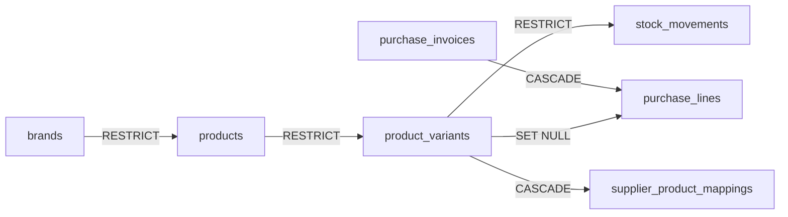

# VGL Cycle Shop — independent Step 3A audit

Date: 19 November 2026 (Asia/Calcutta). Scope: existing code, staging, migration, test claims, and a proposed Step 3B design. Step 3B is not implemented. Application source and Room schema were not edited during this audit.

## Decision and device-test incident

**Step 3A needs corrections before stock posting can safely be added.** Passing tests do not establish the required integrity guarantees.

The physical-device verification had a material preservation failure. After `:app:connectedDebugAndroidTest`, the app package was absent from the OnePlus 9R. The app had existed before that task. A verified database backup was not completed before starting it. After reinstalling the APK, the app's database directory was absent. The original on-device database was not recovered. Therefore this audit cannot claim preservation of pre-test device inventory, purchases, or captured images. The engineer should have completed a verified backup first.

The APK was reinstalled, then the suite was rerun directly with AndroidJUnitRunner. The present database contains the seeded demo state: 6 brands, 8 products, 9 variants, 9 stock movements, 67 stock units, and zero purchase invoices, lines, or mappings. SQLite integrity_check returns `ok`. These current counts are not proof that earlier device history was preserved. No uninstall or database-clear command was issued directly by the audit; the package disappearance occurred during the Gradle-connected test workflow. Its exact cleanup/failure cause remains unresolved.

Future physical verification must use a separate application ID/device or a verified backup and a runner procedure that preserves the installed app. No further connected Gradle runs were made after this incident.

## Repository and actual architecture

- This directory is an Android project, but **not a Git checkout**: `git status` and `git rev-parse --show-toplevel` both fail because no `.git` exists in this directory or its parents. Branch, HEAD, clean/dirty state, and historical diffs cannot be established. No applicable AGENTS.md was found in the project or its ancestors.
- One `app` module; Kotlin, Compose Material 3, Navigation Compose, CameraX, bundled Latin ML Kit, Coil, Room/KSP. Configured minSdk 30, compile/target SDK 37, AGP 9.4.1, Gradle wrapper 9.6.0. These are observed configuration values, not upgrade recommendations.
- `VglApplication` supplies a lazy Room database and two repositories; it asynchronously seeds demo inventory when brands are absent. There is no dependency-injection framework.
- Dashboard and inventory consume Room Flows through ViewModels. The inventory UI exposes search/filtering and demo restock/sale actions. Catalog CRUD exists at DAO level; a complete manual product/variant creation UI is not present in the current navigation.
- Scan flow: CameraX/photo picker → ML Kit → `InvoiceTableParser` → `ProductMatchingEngine` → local Compose review state → `InvoiceScanViewModel.stageInvoiceToDatabase` → `PurchaseRepository` → `PurchaseDao`.
- Staging data access exists, but there is no navigable staged-invoice list/detail flow for reopening and completing verification after app restart.
- Purchase validation/conversion/matching classes live under `ui.invoice`, and `PurchaseRepository` imports the deduplication engine from that package. Preserve working behavior while moving authoritative business rules out of UI in a focused correction.

## Findings, in severity order

### F1 — P1: production parser fabricates complete supplier invoices

Locations: `InvoiceTableParser.kt:195–247`, `253–321`, `95–106`, `155–176`, `329–346`.

The M.STEEL and Stryder branches iterate fixed 11-row and 29-row tables containing descriptions, item codes, quantities, prices, HSNs, and tax rates. They return those values even when no corresponding OCR line exists. Matching a description/code marks numerical fields EXACT without extracting their numbers. Detection is broad enough to select these branches by supplier/location words. Generic bicycle parsing also substitutes quantity 1 and HSN 87120010 and marks them EXACT.

Executed against the rebuilt production classes:

- Header-only `STRYDER / Invoice No: AUDIT-999`, no OCR blocks: 29 items, quantity 62, amount 31,277,000 paise, quantity reconciliation true.
- Header-only `M.STEEL / Invoice No: AUDIT-888`, no OCR blocks: 11 items, quantity 126, amount 1,610,000 paise, reconciliation true.

Document amounts are calculated from returned line amounts; missing document quantity totals fall back to line sums. Reconciliation can therefore compare values with themselves. Existing fixture tests pass partly because production contains the fixture answers.

Correction: retain layout recognition and evidence-based extraction, move invoice answers into test fixtures, and leave absent fields unknown. Capture independently read document totals and distinguish computed totals. Add unfamiliar, changed-price, missing-row, header-only, and shuffled-OCR fixtures before accepting accuracy claims.

### F2 — P1: supplier-aware uniqueness is not enforced by SQLite

Locations: `PurchaseInvoiceEntity.kt:18–19`; `VglDatabase.kt:88–89`; `PurchaseRepository.kt:63–79`; `PurchaseDao.kt:29–42`.

Both composite invoice indexes are ordinary indexes, not UNIQUE. ABORT only rejects actual constraint violations. Repository duplicate lookup occurs before the DAO insert transaction, so concurrent requests can both pass. Direct DAO calls bypass the lookup. Repository lookup uses raw equality; the separate engine uses normalization and supplier-name substring comparisons, which can also falsely reject different suppliers despite conflicting GSTINs.

Executed the exact migration SQL against a disposable SQLite database: two identical supplier/GSTIN/invoice rows inserted successfully; PRAGMA index_list reports unique=0 for every invoice index. The existing device test proves only sequential repository rejection.

Correction: canonical, non-null supplier/document identity backed by SQLite uniqueness, with a precise policy for missing GSTIN and financial-year serial reuse. Preserve raw header values. Preflight existing duplicates before a versioned migration; never delete conflicting history automatically. Posting must also have a durable unique identity and source-line linkage.

### F3 — P1: unit conversion silently changes meaning and quantity

Locations: `UnitConversionEngine.kt:49–138`; `InvoiceScanViewModel.kt:384–431`; `ProductVariantEntity.kt`.

- SET/SETS is treated as a Piece alias and succeeds at 1:1. **There is no valid general Set-to-Piece conversion.**
- PC can be relabeled Gross or Set at 1:1. Pair can be relabeled Gross at 1:1. Dozen ignores an incompatible requested target and returns Pieces.
- `toInt()` truncates fractional base quantities and saturates overflow. NaN/Infinity bypass the non-positive check.
- Staging always requests PIECE. Catalog variants have no persisted base unit to validate that choice.
- RequiresReview warnings are discarded when creating purchase lines; an unknown unit can still receive VERIFIED_MATCH.

Executed examples: 3 Set → 3 Pieces (Success); 3 PC → 3 Gross (Success); 0.5 PC → 0 Pieces (Success); NaN PC → 0 Pieces (Success); Infinity Gross → Int.MAX_VALUE Pieces (Success). NaN and Infinity also receive isValid=true and VERIFIED_MATCH from the validator.

Correction: persist/verify each variant's stock unit without changing existing balances. Only same-unit identity is automatically safe. Gross/Dozen-to-Piece and Pair-to-Piece require compatible item semantics. Set-to-Piece requires owner-approved product-specific contents; Set-to-Set may be 1:1 when the stock item is a set. Unknown/ambiguous conversions must block posting and remain explicitly unresolved. Use finite, exact decimal arithmetic and checked integral/range conversion.

### F4 — P1: suggestions become owner verification without owner action

Locations: `InvoiceScanViewModel.kt:326`, `383`, `438–446`; `ProductMatchingEngine.kt:137–140`; `InvoiceReviewScreen.kt:105`, `560–629`; `PurchaseValidationEngine.kt:58–66`.

Staging falls back to the first candidate regardless of confidence. The matching engine also auto-selects candidates at 0.85. A non-null candidate and clean quality flags can produce VERIFIED_MATCH. Mapping creation writes verifiedByOwner=true for suggestions at 0.75 or above. The review screen displays the best candidate but has no candidate-selection/explicit per-line verification action.

Correction: keep suggestion, selected variant, field correction, unit approval, and explicit owner verification distinct. Editing any material value must invalidate previous verification. Every line must be explicitly verified before posting; rejected/unresolved lines block the whole invoice.

### F5 — P1: raw structured values are overwritten by corrections

Locations: `InvoiceReviewScreen.kt:509–520`; `InvoiceScanViewModel.kt:417–429`; `PurchaseDao.kt:68–81`; `PurchaseRepository.kt:86–93`.

UI edits replace the parsed item's values. Staging then writes the current edited value to both raw and corrected description/quantity/rate/amount fields. Full raw OCR text survives in the header, but the original structured line values and spatial/quality evidence do not survive as a separate immutable snapshot. Unit/header correction provenance is also insufficient.

The later updateLineDetails method changes corrected quantity/price without recomputing effectiveQuantityBase or corrected line amount, and default null arguments overwrite earlier corrections. Executing its SQL on a 10-Gross/1440-Piece line and changing corrected quantity to 2 leaves base quantity at 1440.

Correction: immutable OCR/extraction snapshot plus separate correction fields; explicit edit provenance and verification revision; atomic recomputation of derived values. Distinguish “leave unchanged” from “clear correction.” Enforce validation at the repository boundary as well as the UI.

### F6 — P2: supplier mapping persistence does not provide the claimed behavior

Locations: `PurchaseDao.kt:100–118`; `SupplierProductMappingEntity.kt:26–28`; `InvoiceScanViewModel.kt:240–247`; `ProductMatchingEngine.kt:50–55`.

Mapping natural keys are not unique; REPLACE usually inserts a new auto-ID record rather than updating the supplier/code pair. “Verified” queries do not filter verified_by_owner. A null item code returns an arbitrary first supplier mapping without comparing description. A disposable SQLite probe returned an explicitly unverified FIRST mapping for a null-code lookup. Production matching does not read the mapping table and treats global variant supplier_code equality as a perfect match without supplier scope.

Correction: explicit supplier-scoped keys, owner-only verification, filtered deterministic queries, and exact-code/approved-description lookup. Integrate verified mappings as suggestions while retaining the approved all-lines verification gate.

### F7 — P2: saved source images and future posted history are mutable/deletable

Locations: `InvoiceScanScreen.kt:239–263`; `InvoiceReviewScreen.kt:212–221`; `InvoiceScanViewModel.kt:295–303`; `PurchaseDao.kt:47–55`; `PurchaseRepository.kt:96–97`; `InvoiceStorageManager.kt:36–78`.

After successful staging, the same review screen still permits Discard & Delete, deleting the camera image referenced by the saved invoice. Picker URIs are stored without copying to durable private storage or taking a persistent URI grant. CleanupStaleInvoices currently has no call sites; if enabled as documented, it would delete all aged invoice files without checking saved references. Deletion's canonical-path guard checks filesDir, not specifically the invoices directory.

Invoice deletion is unconditional and cascades to all lines. Status updates and line edits are likewise unguarded. Before posted records exist, these methods need staged-only restrictions and immutable posted history. Future ledger-to-purchase links should use RESTRICT, not permit loss of audit provenance.

Correction: archive/copy images on save, reference-aware cleanup, strict invoice-directory containment, and status/revision guards. Preserve historical documents; use explicit reversal records for later corrections.

### F8 — P2: offline/security and reproducibility cleanup is incomplete

Locations: `app/build.gradle.kts:4,60`; `gradle/libs.versions.toml:13,41`; `AndroidManifest.xml:43–46`; backup XML resources.

No active Gemini/Firebase AI inference call was found in application source; OCR uses bundled ML Kit. However Firebase AI and Google Services are still configured, Firebase AI uses dynamic version 17.+, and the merged manifest contains INTERNET permission and Firebase auto-initialization. “No AI calls found” does not establish that the entire APK performs no network traffic.

allowBackup=true and template backup rules do not establish a deliberate policy for invoice images/OCR and business data. The tested APK is debug-enabled. Before private deployment, remove unused AI configuration, use reproducible pinned dependencies, decide backup/restore behavior, and validate a signed release artifact. No secret values were included in this report.

## What is sound, and what the migration tests prove

Room is version 2, exports schemas 1 and 2, registers MIGRATION_1_2, and has no destructive fallback. The migration adds three purchase tables and their indexes without rewriting the four inventory tables.

Independent host-SQLite execution of all 12 migration statements preserved seeded old rows. Existing entity definitions in exported schemas 1 and 2 are identical. Migrated table_info, foreign_key_list, and index_list metadata match the exported v2 schema for all seven tables. This is useful independent evidence, but not a replacement for Android Room's own migration validation.

The current RoomMigrationTest manually constructs v1 SQL and calls MIGRATION_1_2.migrate on the open database. It does not perform a normal versioned Room reopen, verify room_master_table, or run MigrationTestHelper schema validation. Add actual schema-asset creation, migration and Room reopen coverage, with representative existing inventory/ledger rows and v2 purchase-history preservation in the next migration.

Purchase staging itself has a sound transaction boundary: PurchaseDao.stageInvoiceWithLines inserts the header, rewrites child invoice IDs, inserts lines, and saves mappings in one @Transaction. It contains no InventoryDao call or stock-table writes. The device staging test verifies unchanged total stock, ledger count, and selected variant balance using an isolated in-memory database. The source call path confirms that ordinary staging does not invoke the legacy auto-register/restock method. Demo seeding on fresh app startup is a separate stock-writing operation.

## Room relationships and transaction explanation

Edges show parent → child and behavior when the parent is deleted. There is no suppliers table and no foreign key between purchase lines/invoices and stock movements. Ledger reference_id is only a nullable, non-unique string.

@Relation loads invoice children; @Transaction on relation queries gives a consistent multi-query snapshot. @Transaction on stageInvoiceWithLines makes its writes all-or-nothing. Neither annotation creates a UNIQUE constraint or protects a check performed outside that transaction.

InventoryDao.recordStockMovement already validates direction, checks stock/range using Long, conditionally updates the variant balance, and inserts a movement inside one transaction. Its success/rollback/concurrency tests passed on the phone. This protects **one movement**. Calling it independently for several invoice lines does not make the entire invoice atomic; Step 3B needs an outer transaction on the same Room database.

## Executed verification

| Check | Actual result | Limitation |
| --- | --- | --- |
| `gradlew.bat :app:testDebugUnitTest --rerun-tasks --console=plain` | BUILD SUCCESSFUL; 71 tests, 0 failures/errors/skips across 9 suites | Existing cases miss the integrity failures above |
| `gradlew.bat :app:connectedDebugAndroidTest --console=plain`, selected OnePlus serial | Gradle FAILED; XML reports all 23 cases passing; decoded UTP protobuf also reports PASSED | Overall runner exit remained 1; package/data preservation incident described above |
| Reinstalled APKs; direct `adb -s 192.168.0.9:37157 shell am instrument -w -r dev.vignesh.cycleshop.test/androidx.test.runner.AndroidJUnitRunner` | `OK (23 tests)` on LE2101, Android 14 | 22 feature tests plus 1 template context test; not full manual camera/rotation/restart QA |
| Compiled production-class JVM probes | Reproduced fabricated invoice rows, unsafe conversion and numeric validation | Scratch probes, not added to app test sources |
| Exact migration SQL and DAO SQL on disposable host SQLite | Reproduced duplicate acceptance, stale derived quantity, unverified mapping lookup; migration metadata matches | Host SQLite, not Android Room migration validation |

No app tests were added or edited. Evidence files alongside this report retain the JVM probes, SQLite results, Gradle/direct-run logs, and current device counts. Original business records were not copied into the report. Serena project metadata was generated during code-tool initialization.

## Necessary correction sequence — before Step 3B

1. Establish a recoverable repository baseline and verified device backup/test isolation. Reconcile any missing device history before further development on that installation.
2. Replace fixture-answer parsing, independent-total reconciliation, unsafe numeric conversion, and suggestion-as-verification behavior. Preserve immutable OCR versus corrections and saved images.
3. Introduce canonical supplier/document keys, verified variant stock units, guarded corrections, and deterministic supplier mappings through a new versioned migration (v2 → v3, also test v1 → v3). Keep MIGRATION_1_2 and existing history. Unknown legacy units/identities must require owner review, not reinterpret quantities. Duplicate migration conflicts must be reported without destructive cleanup.
4. Add meaningful regression tests for the reproduced failures, actual Room migration validation, failed multi-write staging rollback, concurrent staging, editing/reopening, and retained image references. Update the earlier architecture report, whose guarantees overstate the implementation.

## Proposed Step 3B plan — requires user review; not implemented

1. **Persisted review flow.** List/reopen staged invoices, edit verified header/line fields and units, explicitly select a valid active variant, and verify every line. Provide owner-confirmed manual product/variant creation with zero stock; never call registerScannedInvoiceItem, which creates products and posts stock. No partial posting: any unresolved/rejected line blocks the entire invoice.
2. **Versioned posting schema.** Add a unique posting identity for the canonical supplier/invoice key and durable purchase-line-to-ledger linkage. Propose supplier identity + normalized invoice number + confirmed financial period where numbers can repeat annually; confirm that identity policy before migration. Make the source purchase-line key unique for PURCHASE ledger entries, leave legacy movement rows intact, and prevent deletion of linked history. Existing ambiguous duplicate documents need explicit resolution without deleting original records.
3. **Authoritative postInvoice(invoiceId, expectedReviewRevision).** One database.withTransaction reloads the header and all lines, returns the saved receipt when already posted, checks state/revision and canonical uniqueness, and validates every line's explicit owner approval, variant, finite/exact positive quantity, approved unit conversion, range and monetary consistency. Group projected deltas by variant for overflow checks, but retain one source-linked ledger entry per invoice line.
4. **One commit.** Within that same transaction, apply all stock deltas and ledger inserts using the existing stock logic, write the posting receipt, and mark the invoice posted. No catching-and-continuing inside the transaction, no per-line commits, no ignored uniqueness violations. Exceptions/cancellation must roll back all stock, ledger, receipt and status writes. Catch errors only after rollback; propagate cancellation correctly. Disable repeat taps for usability, with database uniqueness and transaction state providing actual idempotency across taps, concurrency, restarts, and duplicate staged documents.
5. **Preserve price meaning.** Keep original supplier unit price, invoice unit, conversion and line amount. A Gross price cannot be reused as a per-Piece price. Agree a fractional-paise/rounding and valuation policy before updating catalog cost; the initial posting flow need not silently rewrite cost metadata.
6. **Verification and delivery.** JVM rules plus Android Room tests for all-verified success, one-unverified rejection, no silent skipped lines, duplicate/rapid/concurrent/restart confirmation, repeated variants, failed second-line/ledger writes, cancellation, overflow, missing/inactive variants and edit races. Assert full database snapshots unchanged on failure and stock/ledger parity on success. Exercise review → manual product creation → post → app restart → repeated confirmation on a protected physical installation. Deliver a small reviewable change per correction/feature, with actual commands and results.

No Step 3B implementation, application schema edit, or destructive migration was made. Stop here for owner review.
